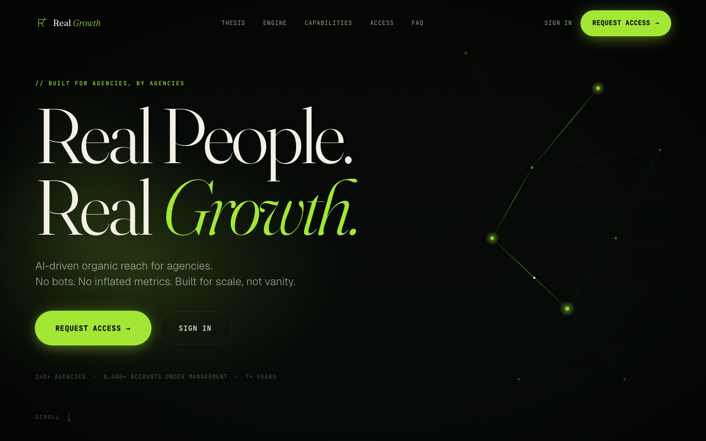

# Real Growth — landing page clone

A working, self-contained clone of the public marketing site at
`https://realgrowth.app` (the landing page, plus matching sign-in and
access-request screens).

Built from observed artifacts, not guesswork: the site's own markup and
stylesheet were captured over HTTP, and the rendered page was captured in a
real Chromium session (screenshots + DOM + network) to confirm what the CSS
actually produces at runtime.



## Run it

No build step, no dependencies:

```bash
cd realgrowth-clone
python3 -m http.server 8099
# open http://127.0.0.1:8099/
```

Opening `index.html` directly from disk also works, except that the Google
Fonts stylesheet needs network access.

## What's here

```
index.html                 landing page (hero, thesis, engine, capabilities, proof, pricing, FAQ, CTA)
login.html                 sign-in screen
register.html              access-request screen
assets/css/styles.css      the whole design system (tokens, layout, components, responsive, reduced motion)
assets/js/main.js          header scroll state, scroll reveal, particle field, mobile drawer, anchor offsets
assets/images/favicon.svg  brand mark favicon
docs/*.png                 reference screenshots of the rendered clone
```

## Design system as observed

| Token | Value | Use |
| --- | --- | --- |
| ink-base | `#070908` | page background |
| ink-card | `#0c1411` | pricing cards |
| ink-elev | `#11181a` | feature hover |
| char | `#a3e635` | the lime accent: buttons, rules, italic display |
| char-bright | `#c5f25a` | primary button hover |
| cream | `#f4f0e6` | headings and body |
| cream-dim / faint | `rgba(244,240,230,.62 / .30)` | secondary copy |
| ash | `rgba(244,240,230,.09)` | hairlines, borders |

Type: **Fraunces** (variable serif, `opsz`/`SOFT` axes, weight ~280–400) for
display; **Geist** for body; **JetBrains Mono** for eyebrows, numerals,
buttons and labels. Container `1280px`, gutter `clamp(24px, 5vw, 72px)`,
section rhythm `clamp(96px, 14vw, 200px)`.

Atmosphere is four stacked fixed layers: a `<canvas>` particle field (64
drifting lime motes, fewer on mobile), an SVG-noise grain at 6% in `overlay`
blend mode, a radial vignette, and a multi-stop radial page gradient.

## Behaviour

- Header compacts and gains a blurred bar after 40px of scroll.
- Sections and the three engine steps fade/rise in via `IntersectionObserver`
  (threshold 0.12).
- Mobile drawer below 960px, with numbered nav, `Esc` to close, body scroll lock.
- Anchors offset by 80px so the fixed header never covers a section title.
- Hero headline and CTA animate in on load with staggered delays.
- `prefers-reduced-motion: reduce` disables particles, reveals and transitions.

## Fidelity notes

- Desktop (1440×900) hero and thesis sections were compared pixel-side against
  runtime captures of the original; capabilities, engine, proof, pricing, FAQ,
  final CTA and footer were rebuilt from the original's own rule values.
- Breakpoints mirror the original: 960 / 880 / 760 / 560 / 540 / 380px.
- All copy, prices and FAQ answers are the original's text, kept so the clone
  reads identically. Fonts load from Google Fonts, as on the original.
- The clone is the **public site only**. Nothing behind `/login` or `/register`
  exists here: those forms are inert (`action="#"`), with no backend, auth,
  session or billing.
- Footer Terms/Privacy links are placeholders (`#`), since those documents
  weren't in scope.
- The original is a PHP app (its asset paths live under `inc/themes/default/`)
  behind Cloudflare; this clone is static HTML/CSS/JS.

## Provenance

Captured on 2026-11-22 from `https://realgrowth.app/`:

- `GET /` → 200, `text/html`, 23,984 bytes
- `GET /inc/themes/default/assets/css/lander.css?v=20260505g` → 200, 33,562 bytes
- `GET /inc/themes/default/assets/js/lander.js?v=20260505d` → 200, 4,992 bytes
- Chromium 157 render: hero at 1440×900 (DSR 2), thesis section, and the
  network log (HTML, CSS, JS, Google Fonts, Cloudflare RUM beacon only — no app
  API calls on the public page).

## If you deploy this

It reproduces another company's brand, copy and design. That's fine for local
study or a demo you clearly label, but publishing it as-is is a trademark and
copyright problem. Swap the wordmark, copy, imagery and accent if it's going
anywhere public.
